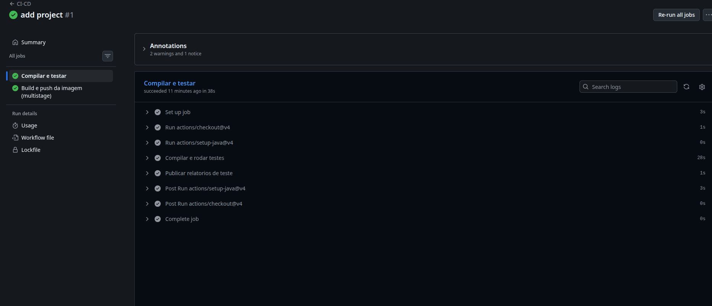
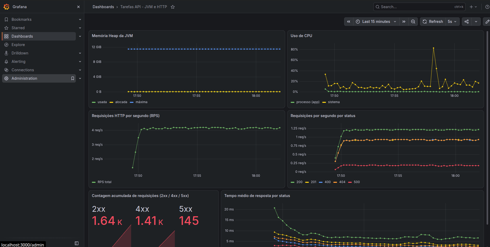
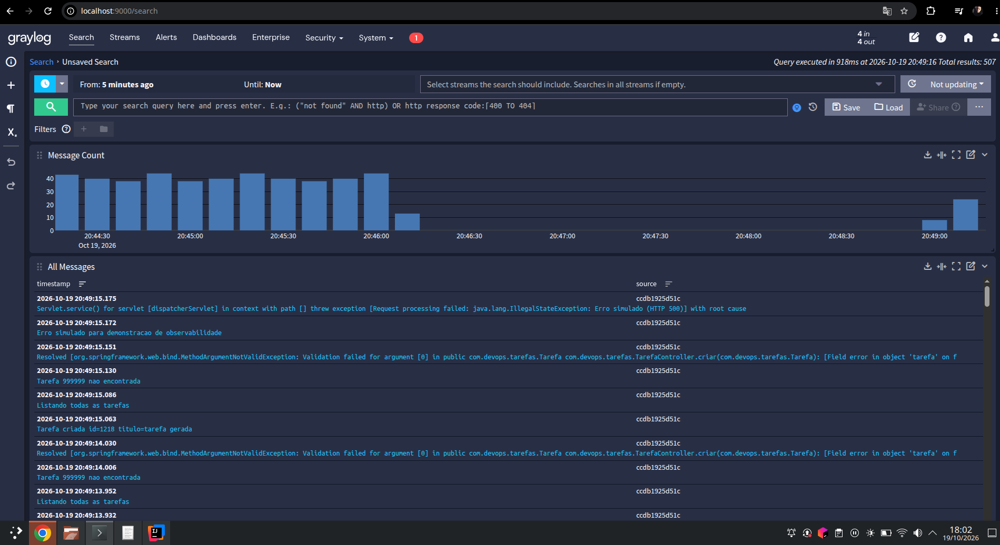

# Tarefas API — Automação, Observabilidade e Esteira DevOps

API REST simples (CRUD de tarefas) em **Java 25 + Spring Boot 3.5**, com banco **H2 em arquivo local**.
O foco do projeto é a **automação**: CI/CD, conteinerização multistage, métricas, dashboards e logs centralizados.

## Arquitetura

| Serviço | Função | Porta |
|---|---|---|
| `app` | API Spring Boot (Actuator + Micrometer + GELF) | 8080 |
| `prometheus` | Scrape de `/actuator/prometheus` a cada 5s | 9090 |
| `grafana` | Dashboard provisionado automaticamente | 3000 |
| `graylog` + `mongodb` + `opensearch` | Gestão centralizada de logs | 9000 |
| `graylog-init` | Cria o input GELF UDP via API (sem passo manual) | — |
| `loadgen` | Gera tráfego (2xx/4xx/5xx) para popular dashboards e logs | — |

## Como executar

Pré-requisitos: Docker + Docker Compose, ~4 GB de RAM livres.
No Linux, o OpenSearch exige: `sudo sysctl -w vm.max_map_count=262144`

```bash
docker compose up --build
```

Aguarde 1–3 minutos (o Graylog é o mais lento). Depois:

- API: http://localhost:8080/api/tarefas
- Métricas: http://localhost:8080/actuator/prometheus
- Prometheus: http://localhost:9090/targets
- Grafana: http://localhost:3000 (admin / admin) → dashboard **Tarefas API - JVM e HTTP**
- Graylog: http://localhost:9000 (admin / admin) → *Search*

Teste rápido:
```bash
curl -X POST localhost:8080/api/tarefas -H 'Content-Type: application/json' -d '{"titulo":"estudar"}'
curl localhost:8080/api/tarefas
```

## Decisões técnicas

- **Multistage build** (`Dockerfile`): estágio 1 `maven:3.9-eclipse-temurin-25` compila o `.jar`; estágio 2 `eclipse-temurin:25-jre-alpine` contém apenas o JRE e roda como usuário não-root.
- **Banco em arquivo**: H2 em modo file (`/app/data/tarefas`), persistido no volume `app-data`.
- **CI/CD** (`.github/workflows/ci-cd.yml`): em push/PR para `main`, roda `mvn verify` (testes), faz o build da imagem e, fora de PR, publica no **GHCR** (`ghcr.io/<usuario>/<repo>`).
- **Métricas**: Actuator + `micrometer-registry-prometheus`; Prometheus faz scrape de `app:8080`.
- **Dashboard** (`grafana/dashboards/tarefas-api.json`): heap da JVM, CPU, RPS, RPS por status, contagem 2xx/4xx/5xx e tempo médio de resposta por status. Datasource e dashboard são provisionados por arquivo.
- **Logs**: Logback com appender GELF (`logstash-gelf`) ativado pelo perfil `gelf`, enviando via UDP para o Graylog. O input GELF é criado automaticamente pelo container `graylog-init`. Níveis INFO, WARN, ERROR e DEBUG ficam pesquisáveis (ex.: `level:3` para erros).

## Evidências

### Pipeline CI/CD


### Dashboard do Grafana


### Logs no Graylog

